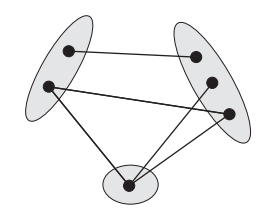
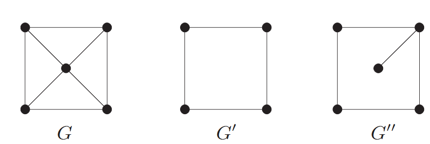
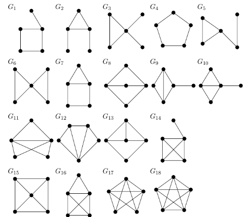
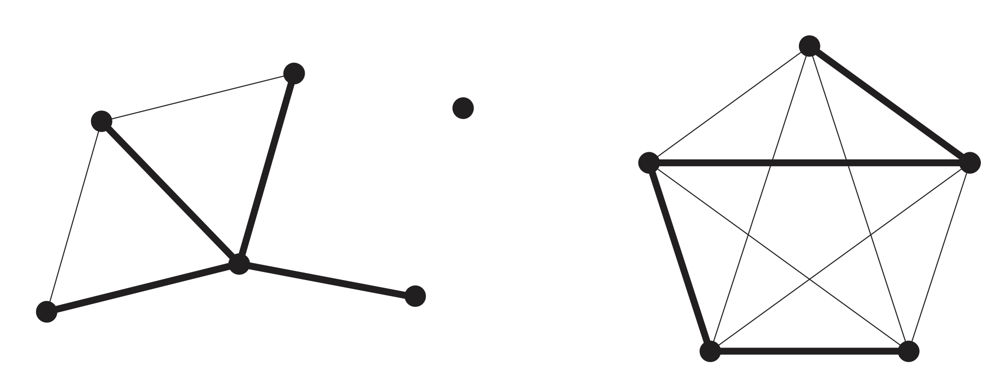

<style>

h1.title,
h1,
h2,
h3,
h4 {
  color: #1F4E79;
  font-weight: bold;
}

h1.title {
  text-align: center;
}

/* Portada */
.portada h1,
.portada h2,
.portada h3,
.portada p {
  color: black;
  font-weight: normal;
}

.portada {
  text-align: center;
  margin-top: 100px;
}

</style>


<div class="portada">

<h2>UNIVERSIDAD NACIONAL DE COLOMBIA</h2>

<h3>Facultad de Ciencias</h3>

<h3>Maestría en Ciencias - Estadística</h3>

<br><br>

<h1>Relatoría: Conceptos fundamentales de teoría de grafos</h1>

<br><br>

<h3>Juan Felipe Moreno</h3>

<br>

<p>Curso: Análisis Estadístico de Redes</p>

<p>Profesor: Juan Sosa, Ph.D.</p>

<br><br>

<p>Bogotá D.C., Colombia</p>

<p>`r format(Sys.Date(), '%d de %B de %Y')`</p>

</div>

<br>


# Introducción

La presente relatoría presenta un compendio de las clases del curso Análisis Estadístico de Redes Sociales, correspondiente al período académico 2026-II de la Maestría en Ciencias Estadísticas. Su objetivo es detallar algunos de los conceptos fundamentales de la teoría de grafos abordados durante las clases y presentes en el material del curso, disponible en El material del curso se encuentra disponible en [Conceptos fundamentales de la teoría de grafos](https://rpubs.com/jstats1702/1375250),elaborado por el profesor Juan Camilo Sosa. Estos contenidos se complementan con ejemplos y bibliografía adicional con el propósito de facilitar la comprensión de los conceptos estudiados.

En esta relatoría se abordará el tercer capítulo del curso, en el cual se presentan y desarrollan conceptos fundamentales de la teoría de grafos que serán necesarios para comprender los temas que se estudiarán posteriormente en el curso. Se hará énfasis en las definiciones, propiedades y representaciones de los grafos, acompañadas de ejemplos que permitan ilustrar su aplicación en el contexto del análisis de redes.

Mediante la teoría de grafos, disponemos de un lenguaje matemático preciso para abordar las redes sociales, donde cada actor se define como un vértice y cada relación como una arista. Este enfoque formal hace factible la caracterización de la topología de la red, permitiendo analizar cuantitativamente la conectividad, las distancias geodésicas y las tendencias de agrupamiento.

# Grafos y Subgrafos

Un **grafo** es un par $G=(V,E)$ formado por dos conjuntos, donde $E\subseteq [V]^2$. Esto significa que los elementos de $E$ son subconjuntos de $V$ que contienen exactamente dos elementos. Para evitar ambigüedades en la notación, se supone siempre que $V\cap E=\varnothing$ [@diestel2017].
Esta definición formal corresponde a un **grafo simple**, el cual es **no dirigido** y **binario**.

Los elementos de $V$ se denominan **vértices** (también llamados nodos o puntos) del grafo $G$.

Los elementos de $E$ se conocen como **aristas** (o enlaces), se pueden representar como parejas de la forma $e=\{u,v\}$ donde $u,v \in V$.

El número de vértices ($\vert{}V\vert{}$) y el número de aristas ( $\vert{}E\vert{}$) se conocen como el **orden** y el **tamaño** del grafo, respectivamente.

Una forma habitual de representar gráficamente un grafo consiste en dibujar un punto por cada vértice y conectar mediante una línea aquellos pares de puntos cuyos vértices correspondientes forman una arista. Lo fundamental es determinar *qué pares de vértices están conectados por una arista y cuáles no*.


Un **grafo dirigido (o digrafo)** es una estructura $D = (V, E)$ compuesta por conjuntos disjuntos de vértices $V$ y aristas $E$, junto con dos funciones $\text{init}: E \to V$ y $\text{ter}: E \to V$. Estas funciones asignan a cada arista $e$ un vértice inicial $\text{init}(e)$ y un vértice terminal $\text{ter}(e)$, indicando que la arista $e$ está dirigida desde $\text{init}(e)$ hacia $\text{ter}(e)$ [@diestel2017]. En este contexto, de manera equivalente, cada arista puede interpretarse como un par ordenado $(u,v) \in V \times V$, representando un enlace orientado formalmente desde el vértice $u$ hacia el vértice $v$.

Una **orientación** de un grafo no dirigido $G$ es un grafo dirigido $D$ tal que $V(D) = V(G)$, $E(D) = E(G)$ y donde $\{\text{init}(e), \text{ter}(e)\} = \{x, y\}$ para cada arista $e = xy \in E(G)$.


```{r Grafos-Comparacion, echo=FALSE, fig.align='center', fig.show='hold', out.width='48%', fig.cap='Ejemplo tomado y adaptado de Diestel, *Graph Theory*, quinta edición, 2017, pág. 2. A la izquierda, un grafo no dirigido con conjuntos $V=\\{1,2,3,4,5,6,7\\}$ y $E=\\{\\{1,2\\},\\{1,5\\},\\{2,5\\},\\{3,4\\},\\{5,7\\}\\}$. A la derecha, su versión orientada.'}
knitr::include_graphics(c("Grafo1.png", "Digrafo1.jpg"))
```

**Grafos ponderados:** Es un grafo $G = (V,E)$ al cual se le asocia una función de peso $w: E \to \mathbb{R}$. Los pesos asignados a cada arista $e \in E$ representan distancias, costos, capacidades o intensidades de interacción entre los vértices.

**Multigrafos:** Un multigrafo es un par $(V,E)$ de conjuntos disjuntos (de vértices y aristas) junto con una aplicación $E \to V \cup [V]^2$ que asigna a cada arista uno o dos vértices, sus extremos. Por lo tanto, los multigrafos también pueden tener *bucles* (cuando una arista conecta a un vértice consigo mismo) y aristas múltiples: podemos pensar en un multigrafo como un grafo dirigido cuyos sentidos de las aristas han sido "olvidados". Para expresar que $x$ e $y$ son los extremos de una arista $e$ seguimos escribiendo $e = xy$, aunque esto ya no determina a $e$ de manera única [@diestel2017]. Un grafo que no es un multigrafo se denomina grafo **simple**.

**Grafos $r$-partitos:** Sea $r \geq 2$ un número entero. Un grafo $G = (V, E)$ se denomina $r$-partito si su conjunto de vértices $V$ admite una partición en $r$ clases disjuntas, de modo que toda arista tiene sus extremos en clases diferentes (es decir, los vértices pertenecientes a una misma clase no son adyacentes). Cuando $r = 2$, el grafo se denomina simplemente **bipartito** [@diestel2017].

```{r GrafoTripartito, echo=FALSE, fig.align='center', out.width='60%', fig.cap='Ejemplo tomado de Diestel, *Graph Theory*, quinta edición, 2017, pág. 17. Grafo tripartito'}

```


## Subgrafo y Supergrafo

-  Sea $G'=(V',E')$. Decimos que $G'$ es un $\textbf{subgrafo}$ de $G$ si, para $G=(V,E)$, se cumple que $V'\subset V$ y, al mismo tiempo, $E'\subset E$

 -  De manera equivalente podemos definir la noción de $\textbf{supergrafo}$, donde $G$ es un supergrafo de $G'$ por el hecho de que $V'\subseteq V$ y $E'\subseteq E$
 
Por facilidad de notación se usa $G′ \subset G$ para indicar que $G′$ es un subgrafo de $G$.
 
### Subgrafo inducido

Sea $S\subset V$ un subconjunto de vértices. El $\textbf{subgrafo inducido}$ por $S$ es el grafo $G_S=(S,E_S)$ que contiene exactamente los vértices de $S$ y todas y solo las aristas del grafo original cuyos extremos pertenecen a $S$.
Formalmente,
$$E_S=\{\{u,v\}\in E:u\in S,v\in S\}.$$

En otras palabras, un subgrafo inducido se obtiene al seleccionar un subconjunto de vértices $S\subset V$ y conservar *todas las aristas de* $G$ *que conectan pares de vértices pertenecientes a* $S$. Por lo tanto, una vez seleccionado el conjunto de vértices, el conjunto de aristas queda completamente determinado.


```{r GrafoSuperYSub, echo=FALSE, fig.align='center', out.width='60%', fig.cap='Ejemplo tomado de Diestel, *Graph Theory*, quinta edición, 2017. pg.4'}

```

En este ejemplo $G$ es supergrafo de $G'$ y $G''$ (lo que es equivalente a decir que  $G′$ and $G′′$ son subgrafos de $G$ ) Tenemos que $G′$ es un grafo inducido de $G$, pero $G′′$ no lo es.


#### Ejemplo
Vamos a usar la librería *igraph* [@csardi2006] para todos los ejemplos a utilizar.

```{r setup, message=FALSE, warning=FALSE}
#Carga de librerias
suppressMessages(suppressWarnings(library(sand)))
suppressMessages(suppressWarnings(library(igraph)))
suppressMessages(suppressWarnings(library(RColorBrewer)))
suppressMessages(suppressWarnings(library(corrplot)))
suppressMessages(suppressWarnings(library(dplyr)))
suppressMessages(suppressWarnings(library(jsonlite)))
suppressMessages(suppressWarnings(library(readxl)))
suppressMessages(suppressWarnings(library(igraphdata)))
suppressMessages(suppressWarnings(library(knitr)))
suppressMessages(suppressWarnings(library(magick)))
```

Vamos a crear un grafo binario no dirigido simple, desde cero  con vértices $V=\{1,2,3,4,5,6,7\}$ y aristas $E= \left\{ \{1,2\}, \{1,3\},\{2,3\}, \{2,4\}, \{3,5\}, \{4,5\},\{3,4\}, \{3,6\}, \{4,6\}, \{4,7\}, \{5,6\}, \{6,7\} \right\}$ 

Este grafo fue usado en el libro guía: Statistical Analysis of Network Data  [@kolaczyk2020]

```{r}


# Grafo G
g <- graph_from_literal(
  1-2, 1-3, 2-3, 2-4, 3-5, 4-5,
  3-4, 3-6, 4-6, 4-7, 5-6, 6-7
)

# Subgrafo inducido H por los vértices 1,...,5
h <- induced_subgraph(g, 1:5)

# Configuración de la figura
par(mfrow = c(1, 2), mar = c(1, 1, 3, 1))

# Graficar G
set.seed(123)
plot(
  g,
  layout = layout_with_fr(g),
  vertex.color = "#4C78A8",
  vertex.frame.color = "white",
  vertex.frame.width = 2,
  vertex.size = 30,
  vertex.label.color = "white",
  vertex.label.cex = 1.2,
  edge.color = "#777777",
  edge.width = 2,
  main = "Grafo G"
)

# Graficar H
set.seed(123)
plot(
  h,
  layout = layout_with_fr(h),
  vertex.color = "#F58518",
  vertex.frame.color = "white",
  vertex.frame.width = 2,
  vertex.size = 30,
  vertex.label.color = "white",
  vertex.label.cex = 1.2,
  edge.color = "#777777",
  edge.width = 2,
  main = "Subgrafo inducido H"
)

# Restaurar configuración
par(mfrow = c(1, 1))

```


# Propiedades de los grafos

Sean $u,v \in V$

-  **Adyacencia** Se dice que dos vértices son adyacentes (denotado como $u \sim v$), si están unidos por alguna arista de $E$, es decir si $\{u,v\} \in E$ (relación vértice - vértice)

-  **Incidencia** Un vértice $v$ es incidente con una arista $e \in E$ si $e=\{u,v\}$ para algún $u\in V.$


-  **Vecindad**: Es el conjunto de vértices adyacentes a $v$ , se denota como $N_v= \{u \in V : u\sim v\}.$

- El **grado** de un vértice $v$ es el número de aristas incidentes en $v$ y coincide con la cardinalidad de su vecindad: $d_v = |N_v|.$


- Un vértice $v\in V$ se llama **aislado** si $v\nsim u \hspace{0.1cm} \forall_{u\in V}$. Note que esto es equivalente a que $d_v=0$.


-  Sea $G=(V,E)$  podemos definir $\delta_G := \min \{d_v | v \in V \}$ así como $\Delta_G := \max \{d_v | v \in V \}$, que corresponden al grado mínimo y al grado máximo de $G$, respectivamente. Estas medidas permiten identificar los vértices menos conectados y más conectados de la red.

-  Otra cantidad de interés es el **grado promedio** de $G$, denotado por $\bar{d}_G:= \frac{1}{|V|} \sum_{v \in V} d_v$

Mientras que el grado de un vértice describe su nivel de conectividad (lo veremos en un momento) de manera local, el grado promedio resume esta información a nivel global para todo el grafo. 


-  En un digrafo, podemos distinguir entre la **vecindad de entrada** y la **vecindad de salida** de un vértice $v \in V$. La vecindad de entrada de $v$ es el conjunto de vértices que tienen una arista dirigida hacia $v$: $N_v^{in}=\{u\in V:(u,v)\in E\}.$

-  A partir de este conjunto, se define el **grado de entrada** de $v$ como : $d_v^{in}=|N_v^{in}|,$ que corresponde al número de aristas que llegan a $v$. 

-  De manera análoga, la **vecindad de salida** de $v$ es el conjunto de vértices hacia los cuales $v$ tiene una arista dirigida:$N_v^{out}=\{u\in V:(v,u)\in E\}.$

-  El **grado de salida** de $v$ se define como $d_v^{out}=|N_v^{out}|$ y corresponde al número de aristas que salen de $v$.

<small>**Nota de interpretación:** 
 El grado Es una medida de *centralidad* de la red que permite definir un tipo de noción de *"importancia"* de los vértices. El significado práctico de los grados de entrada y salida varía según la naturaleza de la red. Por ejemplo, en una red social, un $d_v^{in}$ elevado refleja *popularidad*, mientras que un $d_v^{out}$ elevado representa una alta *sociabilidad* (o actividad del usuario). En citas académicas, $d_v^{in}$ indica el impacto o influencia de un artículo, mientras que $d_v^{out}$ refleja la extensión de su marco de referencias. Finalmente, en modelos epidemiológicos, $d_v^{in}$ mide el grado de exposición al contagio y $d_v^{out}$ el potencial de transmisión a otros individuos.</small>


**Teorema.** Sea $G=(V,E)$ un grafo no dirigido y $D = (V', E')$ un digrafo. Se tienen las siguientes identidades:

1. Para el grafo no dirigido $G$:
   $$\sum_{v \in V} d(v) = 2|E|$$

2. Para el dígrafo $D$:
   $$\sum_{v \in V'} d_v^{in} = \sum_{v \in V'} d_v^{out} = |E'|$$

## Ejemplos

Considérese el siguiente digrafo:

```{r}
dg <- graph_from_literal(
  1-+2, 1-+3, 1-+4,
  2-+3, 2-+5,
  3-+5,
  4-+2,
  6-+3,
  7
)
```

```{r}
# Tamaño , Orden , Tipo de red
cat(
  "Orden (número de nodos):", vcount(dg), "\n",
  "Tamaño (número de aristas):", ecount(dg), "\n",
  "¿Es dirigida?:", is_directed(dg), "\n",
  "¿Es ponderada?:", is_weighted(dg), "\n",
  "¿Es simple?:", is_simple(dg), "\n")
```

```{r}
par(mfrow = c(1,1), mar = c(1, 1, 2, 1))
set.seed(123)
plot(
  dg,
  vertex.color = "skyblue",
  vertex.size = 30,
  vertex.label.cex = 1.2,
  edge.arrow.size = 0.4,
  main = "Digrafo"
)
```


```{r}
# Grado de entrada
degree(dg, mode = "in")
```

```{r}
# Grado de salida
degree(dg, mode = "out")
```
```{r}
#Grado Máximo y Promedio:
cat("Grado promedio:",mean_degree(dg),"\n", "Grado máximo:", max_degree(dg))
```
```{r}
par(mfrow = c(1,2))

#Distribución de grados de entrada vs grados de salida en dg

# 1. Calcular frecuencias del grado de entrada
deg_in <- degree(dg, mode = "in")
freq_in <- table(deg_in)

# 2. Generar el barplot
barplot(
  freq_in,
  col = "#F58518",
  main = "Grado de entrada",
  xlab = "d_in",
  ylab = "Frecuencia"
)

# 1. Calcular frecuencias del grado de salida
deg_out <- degree(dg, mode = "out")
freq_out <- table(deg_out)

# 2. Generar el barplot
barplot(
  freq_out,
  col = "#4C78A8",
  main = "Grado de salida",
  xlab = "d_out",
  ylab = "Frecuencia"
)
```


Ahora vamos a convertir a ese grafo dirigido en uno no-dirigido:

```{r}
g_ud <- as_undirected(dg)
```

Encontremos entonces vértices adyacentes, aislados y aristas incidentes

```{r}
# Vértices aislados
V(g_ud)[degree(g_ud) == 0]
```

```{r}
# Vértices adyacentes a 2
(nb2 <- neighbors(g_ud, v = 2))
```

```{r}
# Aristas incidentes en el vértice 2
(ic2 <- incident(g_ud, v = 2, mode = "all"))
```
```{r}

# Colores de vértices
v_col <- rep("lightblue", vcount(g_ud))
v_col[2] <- "khaki"
v_col[as.numeric(nb2)] <- "khaki"

# Colores de aristas
e_col <- rep("grey70", ecount(g_ud))
e_col[ic2] <- "khaki"

# Visualización
par(mfrow = c(1,1), mar = c(1,1,2,1))

par(mfrow = c(1,1), mar = c(1, 1, 2, 1))
set.seed(123)
plot(
  g_ud,
  layout = layout_with_fr(g_ud),
  vertex.color = v_col,
  vertex.size = 30,
  vertex.label.cex = 1.2,
  vertex.frame.color = "white",
  edge.color = e_col,
  edge.width = ifelse(e_col == "khaki", 3, 1),
  main = "Vecindad del vértice 2"
)
  
```

# Movimiento

- Una **caminata** (*walk*) de \(v_0\) a \(v_\ell\) de longitud \(\ell\) es una secuencia alternante de vértices y aristas $\{v_0,e_1,v_1,e_2,v_2,\ldots,v_{\ell-1},e_\ell,v_\ell\}$ tal que, para cada \(i = 1,\ldots,\ell\), los extremos de \(e_i\) son \(\{v_{i-1},v_i\}\). En una caminata se permiten vértices y aristas repetidos. Notemos que la longitud de una caminata \(\ell\) coincide con el número de aristas en la caminata.

- Una **caminata cerrada** es aquella en la que el vértice inicial coincide con el vértice final, es decir, $v_0=v_{\ell}$, por ejemplo: $$1 \rightarrow 2 \rightarrow 3 \rightarrow 2 \rightarrow 4 \rightarrow 2 \rightarrow 1$$ .

- En caso contrario decimos que es una **caminata abierta**, por ejemplo: $$1 \rightarrow 2 \rightarrow 3 \rightarrow 2 \rightarrow 4$$.

- Un **Recorrido** (*trail*) es una caminata en la que no se repite ninguna arista (aunque si pueden repetirse vértices).


- Un **Camino** (*path*) es un recorrido en el que no se repite ningún vértice.

En el caso de los dígrafos las caminatas y los caminos deben respetar la orientación de las aristas.

```{r Recorrido Caminata Camino, echo=FALSE}
par(mfrow = c(1,3), mar = c(1,1,3,1))

#Grafo de base:
g <- graph_from_literal(
  1-2, 1-3,
  2-3, 2-4,
  3-5,
  4-5, 4-6,
  5-6
)

# Layout fijo
lay <- matrix(
  c(
     0,  2,   # 1
    -1,  1,   # 2
     1,  1,   # 3
    -1,  0,   # 4
     1,  0,   # 5
     0, -1    # 6
  ),
  byrow = TRUE,
  ncol = 2
)

# 1. CAMINATA
# (repite la arista 2-3)

walk_seq <- c("1","2","3","2","4")

walk_vertices <- unique(walk_seq)

walk_edges <- c(
  "1|2",
  "2|3",
  "2|4"
)

v_col <- ifelse(
  V(g)$name %in% walk_vertices,
  "chartreuse3",
  "grey90"
)

e_col <- sapply(E(g), function(e){

  extremos <- ends(g,e)

  etiqueta <- paste(
    sort(extremos),
    collapse="|"
  )

  if(etiqueta %in% walk_edges)
    "chartreuse3"
  else
    "grey75"

})

plot(
  g,
  layout = lay,
  vertex.color = v_col,
  vertex.frame.color = "white",
  vertex.size = 30,
  edge.color = e_col,
  edge.width = ifelse(e_col=="chartreuse3",4,1.5),
  main = "Caminata"
)

mtext(
  "1 → 2 → 3 → 2 → 4 → 2 → 1",
  side = 1,
  line = -1.5,
  cex = .8
)

# 2. RECORRIDO
# NO repite aristas

trail_seq <- c("1","2","3","5","4","2")

trail_vertices <- unique(trail_seq)

trail_edges <- c(
  "1|2",
  "2|3",
  "3|5",
  "4|5",
  "2|4"
)

v_col <- ifelse(
  V(g)$name %in% trail_vertices,
  "chartreuse3",
  "grey90"
)

e_col <- sapply(E(g), function(e){

  extremos <- ends(g,e)

  etiqueta <- paste(
    sort(extremos),
    collapse="|"
  )

  if(etiqueta %in% trail_edges)
    "chartreuse3"
  else
    "grey75"

})

plot(
  g,
  layout = lay,
  vertex.color = v_col,
  vertex.frame.color = "white",
  vertex.size = 30,
  edge.color = e_col,
  edge.width = ifelse(e_col=="chartreuse3",4,1.5),
  main = "Recorrido"
)

mtext(
  "1 → 2 → 3 → 5 → 4 → 2",
  side = 1,
  line = -1.5,
  cex = .8
)

# 3. CAMINO
# NO repite vértices

path_seq <- c("1","3","5","6")

path_edges <- c(
  "1|3",
  "3|5",
  "5|6"
)

v_col <- ifelse(
  V(g)$name %in% path_seq,
  "chartreuse3",
  "grey90"
)

e_col <- sapply(E(g), function(e){

  extremos <- ends(g,e)

  etiqueta <- paste(
    sort(extremos),
    collapse="|"
  )

  if(etiqueta %in% path_edges)
    "chartreuse3"
  else
    "grey75"

})

plot(
  g,
  layout = lay,
  vertex.color = v_col,
  vertex.frame.color = "white",
  vertex.size = 30,
  edge.color = e_col,
  edge.width = ifelse(e_col=="chartreuse3",4,1.5),
  main = "Camino"
)

mtext(
  "1 → 3 → 5 → 6",
  side = 1,
  line = -1.5,
  cex = .8
)

par(mfrow = c(1,1))
```

# Conectividad

-  Se dice que un vértice $v$ es **accesible** *(reachable)* desde otro vértice $u$ si existe al menos una caminata desde $u$ hasta $v$.[@kolaczyk2020]

-  Se dice que un grafo está **conectado** *(connected)* si cada vértice es accesible desde cualquier otro. [@kolaczyk2020], es decir si entre cada par de vértices $u,v$, existe una caminata que los une.

### Grafos conexos con 5 vértices

En el siguiente gráfico vamos a poder observar los posibles Grafos conexos con 5 vértices y al menos 5 aristas.

```{r Grafo5, echo=FALSE, fig.align='center', out.width='60%', fig.cap="Ejemplo tomado de [@kemnitz2016sum]"}

```


-  Un dígrafo es **débilmente conexo** (o *débilmente conectado*, del inglés *weakly connected*) si su *grafo subyacente*, obtenido al ignorar la dirección de las aristas, es conectado.
 
-  Un dígrafo es **fuertemente conexo** (o *fuertemente conectado*, del inglés *strongly connected*) si, para todo par de vértices $u,v$ existe una caminata dirigida de $u$ a $v$ ($u$ → $v$) y de $v$ a $u$ ($v$ → $u$). Es decir, si cada vértice es accesible desde cualquier otro mediante aristas dirigidas.

### Grafo Subyacente:

Dado un grafo dirigido (digrafo) $D = (V, E)$ con matriz de adyacencia binaria $\mathbf{Y} = [y_{ij}]$, el **grafo no dirigido subyacente** $G = (V, E_u)$ se obtiene al eliminar la orientación de las aristas.

Desde la perspectiva matricial, la simetrización elemental $\mathbf{Y} + \mathbf{Y}^T$ resulta insuficiente en presencia de aristas bidireccionales ($y_{ij} = y_{ji} = 1$), ya que produce entradas iguales a $2$, perdiendo el carácter binario de la red. 

Para resolver esto, la matriz de adyacencia simétrica $\mathbf{A} = [a_{ij}]$ del grafo subyacente se define formalmente como:

$$a_{ij} = \mathbf{1}_{\{y_{ij} + y_{ji} > 0\}} = \min(1, y_{ij} + y_{ji})$$

o bien, mediante la operación elemento a elemento (*operador OR lógico*): $a_{ij} = y_{ij} \lor y_{ji}$.

#### Ejemplo numérico

Considerando la matriz de adyacencia del digrafo:

$$\mathbf{Y} = \begin{pmatrix} 0 & 0 & 0 & 1 \\ 0 & 0 & 1 & 1 \\ 0 & 0 & 0 & 0 \\ 0 & 0 & 0 & 0 \end{pmatrix}$$

Su transpuesta es:

$$\mathbf{Y}^T = \begin{pmatrix} 0 & 0 & 0 & 0 \\ 0 & 0 & 0 & 0 \\ 0 & 1 & 0 & 0 \\ 1 & 1 & 0 & 0 \end{pmatrix}$$

Aplicando la regla de binarización $a_{ij} = \mathbf{1}_{\{y_{ij} + y_{ji} > 0\}}$, obtenemos la matriz de adyacencia simétrica del grafo subyacente:

$$\mathbf{A} = \begin{pmatrix} 0 & 0 & 0 & 1 \\ 0 & 0 & 1 & 1 \\ 0 & 1 & 0 & 0 \\ 1 & 1 & 0 & 0 \end{pmatrix}$$


Veamos como se vería la visualización del dígrafo G y su grafo subyacente.

```{r tres-grafos, echo=TRUE, fig.align='center', fig.width=12, fig.height=4, fig.cap="Comparación de Grafos"}

# 1. Matriz de adyacencia original (Digrafo Y)
Y <- matrix(c(0, 0, 0, 1,
              0, 0, 1, 1,
              0, 0, 0, 0,
              0, 0, 0, 0), 
            nrow = 4, byrow = TRUE)


# 2. Matriz binaria Y* (Grafo subyacente)
Y_star <- (Y | t(Y)) * 1

# Crear los dos objetos de grafo
g1 <- graph_from_adjacency_matrix(Y, mode = "directed")
g2 <- graph_from_adjacency_matrix(Y_star, mode = "undirected")

# Disposición circular compartida para mantener la coherencia visual
set.seed(123)
lay <- layout_in_circle(g1)

# Configurar el lienzo para 3 gráficos (1 fila, 3 columnas)
par(mfrow = c(1, 2), mar = c(1, 1, 3, 1))

# Panel 1: Digrafo Original Y
set.seed(123)
plot(g1, layout = lay,
     vertex.color = "#F58518", vertex.size = 35,
     vertex.label.cex = 1.3, vertex.label.color = "white",
     edge.arrow.size = 0.5, edge.color = "gray30", edge.width = 2,
     main = "1. Digrafo Original G")


# Panel 2: Grafo Subyacente (Y*)
set.seed(123)
plot(g2, layout = lay,
     vertex.color = "#4C78A8", vertex.size = 35,
     vertex.label.cex = 1.3, vertex.label.color = "white",
     edge.color = "gray30", edge.width = 2,
     main = "3. Grafo Subyacente G*")

# Restaurar la configuración original de gráficos
par(mfrow = c(1, 1))
```

### Componente conexa

-  Una **componente conexa** (*connected component*) o simplemente *componente* de un grafo es un *subgrafo conexo maximal*, es decir, un subgrafo conexo al que no se le puede añadir ningún otro vértice del grafo sin perder la conectividad (o, equivalentemente, sin dejar de ser conexo). 

**Nota:** Que un subgrafo sea *conexo maximal* no implica que sea un *grafo completo*. La conexidad exige únicamente la existencia de al menos un camino entre cualquier par de vértices del subgrafo, no que todos los vértices estén directamente conectados entre todos.


```{r GrafoCon, echo=FALSE, fig.align='center', out.width='60%', fig.cap='Un grafo con tres componentes conexas, Ejemplo tomado de Diestel, *Graph Theory*, quinta edición, 2017. pg.11'}

```


- La **componente conexa de mayor tamaño** (a menudo denominada *componente gigante*) es el subgrafo conexo que agrupa el mayor número de vértices. En este subgrafo, todos los nodos son accesibles entre sí mediante al menos un camino. En redes de gran escala, esta componente suele concentrar una fracción significativa del total de vértices y la mayor parte de las trayectorias del grafo.

 <small> **Nota:** Formalmente, en teoría de grafos aleatorios, el término *componente gigante* se reserva para el régimen asintótico ($n \to \infty$), donde la componente principal abarca una fracción macroscópica y proporcional del total de vértices del sistema (es decir, $|V_{max}| \propto n$). En grafos finitos, es preferible referirse a ella como la *componente conexa principal* o *componente conexa de mayor tamaño* (*largest connected component*). </small>

- Las **Asignaciones** *(Memberships)* de las componentes indican la pertenencia de cada nodo a una componente. En particular, $\xi_i=k$ significa que el (i)-ésimo nodo pertenece a la componente $k$, donde $i=1,2,\ldots,n=|V|$ y $\quad k=1,2,\ldots,K$, siendo $K$ el número total de componentes. Y su vector asociado está dado por:


$$\boldsymbol{\xi}
=
\begin{pmatrix}
\xi_1\\
\xi_2\\
\vdots\\
\xi_n
\end{pmatrix}$$

De manera equivalente, la componente $C_k$ se puede definir como el conjunto de nodos cuya asignación es $k$ :$\quad C_k= \left\{i \in V: \xi_i =k \right\}$ 

## Ejemplo 

```{r}
library(igraph)

# 1. Red
set.seed(123)
g <- graph_from_literal(
  A--B, A--C, A--D, B--C, B--E, B--F,
  C--D, C--F, D--F, D--G, E--F, E--H,
  F--G, F--H, G--H, G--I, H--I, H--J,
  I--J, I--K, J--K, J--L, K--L, K--M,
  L--M, M--N, M--O,
  
  P--Q, P--R, Q--R, Q--S, R--S, S--T,
  
  U,
  V
)
```

```{r}
is_connected(g)
```


```{R}
# 2. Encontrar la componente gigante
comp <- components(g)
comp
```


```{R}
giant_id <- which.max(comp$csize)
set.seed(123)
g_giant <- induced_subgraph(
  g,
  vids = V(g)[comp$membership == giant_id]
)

# 3. Calcular layouts

set.seed(123)
lay_g <- layout_with_fr(g)
set.seed(123)
lay_giant <- layout_with_fr(g_giant)

# 4. Comparar la red y la componente gigante

par(
  mfrow = c(1, 2),
  mar = c(1, 1, 3, 1)
)
set.seed(123)
plot(
  g,
  layout = lay_g,
  vertex.size = 10,
  vertex.color = "steelblue",
  vertex.frame.color = "white",
  vertex.label = NA,
  edge.color = "grey60",
  edge.width = 1.5,
  main = "Red completa"
)
set.seed(123)
plot(
  g_giant,
  layout = lay_giant,
  vertex.size = 10,
  vertex.color = "firebrick2",
  vertex.frame.color = "white",
  vertex.label = NA,
  edge.color = "grey60",
  edge.width = 1.5,
  main = "Componente gigante"
)
```

## Ejemplo 2 Red de Citación VIH

La red representa el patrón de citación entre 146 blogs relacionados con el VIH/sida, los pacientes y sus redes de apoyo, recopilados por Suchi Gopal [@gopal2007] durante un período de tres días seleccionado aleatoriamente en agosto de 2005. Los vértices representan los blogs y las aristas dirigidas representan las relaciones de referencia entre ellos: una arista desde un blog hacia otro indica que el primero incluye un enlace al segundo en su página web, específicamente dentro de su lista de enlaces o *blogroll*.


```{r}
data(aidsblog)
g <- aidsblog
g$name <- "AIDS Blog Network"
```

```{r}
# Tamaño , Orden , Tipo de red
cat(
  "Orden (número de nodos):", vcount(g), "\n",
  "Tamaño (número de aristas):", ecount(g), "\n",
  "¿Es dirigida?:", is_directed(g), "\n",
  "¿Es ponderada?:", is_weighted(g), "\n",
  "¿Es simple?:", is_simple(g), "\n")

```

```{r}
cat("Red Conectada débilmente?:", is_connected(graph = g, mode = "weak"), "\n",
"Red Conectada fuertemente?:", is_connected(graph = g, mode = "strong"))
```

```{r}
set.seed(123)
lay <- layout_with_fr(g)

plot(
  g,
  layout = lay,
  vertex.size = 7,
  vertex.label = NA,
  vertex.color = V(g)$color,
  vertex.frame.color = "white",
  edge.color = "gray70",
  edge.arrow.size = 0.15,
  edge.width = 1,
  main = "Red de Blogs sobre VIH/SIDA"
)
```
```{r}
# Componentes débilmente conectadas
components(g, mode = "weak")
```
```{r}
# Componentes débilmente conectadas
components(g, mode = "strong")
```


# Distancia

-  Una noción común de **distancia** entre dos vértices $u$ y $v$ de un grafo, denotada por $d(u,v)$, se define como la longitud del *camino más corto* entre ellos. Si no existe ningún camino que conecte los dos vértices, la distancia se define como infinita, es decir, $d(u,v) = \infty$. A menudo, esta distancia se denomina **distancia geodésica**, y *geodésico* es el término utilizado para referirse a un camino más corto [@kolaczyk2020].

-  El **diámetro** de un grafo $G=(V,E)$, denotado por $\operatorname{diam}(G)$, es la *mayor distancia geodésica finita* entre cualquier par de vértices $u,v\in V$: 
$$\operatorname{diam}(G) = \max_{\{u,v \in V \mid d(u,v) < \infty\}} d(u,v)$$


-  La **distancia geodésica promedio** es el promedio de las distancias geodésicas entre pares de vértices conectados y proporciona una medida del grado de separación global de los vértices del grafo.

 - La **excentricidad** de un vértice $v \in V$, denotada por $\epsilon(v)$, representa la mayor distancia geodésica entre $v$ y cualquier otro vértice $u$ alcanzable desde él:

  $$\epsilon(v) = \max_{\{u \in V \mid d(u,v) < \infty\}} d(u,v)$$
 - Bajo esta relación, el diámetro del grafo equivale al máximo de las excentricidades de todos sus vértices: $\operatorname{diam}(G) = \max_{v \in V} \epsilon(v)$.


<small> **Nota:** Si el grafo $G$ no es conexo, existen pares de vértices para los cuales $d(u,v) = \infty$. Esto implica que tanto el diámetro como las excentricidades toman valor infinito ($\infty$). Sin embargo, en el análisis de redes y en entornos computacionales (como la librería `igraph` en R), la convención estándar consiste en restringir estas métricas al conjunto de distancias finitas ($d(u,v) < \infty$). Esto equivale a calcular la excentricidad y el diámetro dentro de cada componente conexa individualmente, permitiendo conservar el valor analítico de ambas métricas en redes reales desconectadas.</small>

Las medidas como el diámetro, la distancia geodésica promedio y el grado promedio se denominan **estructurales** (o globales) porque caracterizan la red en su conjunto, mientras que el grado es una medida **locales** porque caracterizan el comportamiento individual de cada vértice.

Tomemos el siguiente ejemplo:
```{r}
g <- graph_from_literal(1-2, 2-3, 3-4, 4-5, 3-5)
```

```{r}
# Visualizar el grafo (opcional)
set.seed(123)
plot(g, vertex.color = "#4C78A8", vertex.size = 30, vertex.label.cex = 1.2,vertex.label.color = "white",main="Red Binaria No dirigida")
```
```{r}
# 2. Matriz de distancias geodésicas 
distances(g)
```
```{r}
# 3. Excentricidad de cada vértice
eccentricity(g)
```

```{r}
# 4. Diámetro de la red
diameter(g)
```
```{r}
# 5. Distancia geodésica promedio
mean_distance(g, directed = FALSE)
```

#### Extensión a grafos dirigidos:

En un digrafo $D = (V, E)$, las distancias geodésicas respetan la orientación de las aristas. Por lo tanto, la distancia deja de ser simétrica ($d(u,v) \neq d(v,u)$ en general), representando la longitud del camino dirigido más corto desde $u$ hasta $v$. En este contexto:

 - La **excentricidad de salida** ($\epsilon^{out}(v)$) considera los caminos desde $v$ hacia los demás nodos, mientras que la **excentricidad de entrada** ($\epsilon^{in}(v)$) evalúa los caminos que llegan a $v$.
 - Si el digrafo no es **fuertemente conexo**, existirán pares donde no hay camino dirigido ($d(u,v) = \infty$). Por convención en el análisis de redes, el diámetro se define sobre las distancias dirigidas finitas existentes o bien se calcula de forma no dirigida sobre el grafo subyacente, según el objetivo del estudio.

# Ejemplos

## Ejemplo French Political Blogs

El conjunto de datos **French Political Blogs** corresponde a una subred de blogs políticos franceses extraída de una recopilación superior a 1.100 blogs observados durante octubre de 2006.


Los blogs fueron clasificados según su afiliación política por el proyecto *Observatoire Présidentielle*. La red contiene:

- 192 blogs (nodos).
- 1.431 relaciones (aristas).
- Diversos partidos políticos representados mediante atributos de los nodos.

```{r}
summary(fblog)
```
```{r}
V(fblog)$PolParty <- trimws(V(fblog)$PolParty)
party.names <- unique(V(fblog)$PolParty)
head(party.names)


```

La variable `PolParty` contiene la afiliación política de cada blog y será utilizada para diferenciar visualmente los nodos mediante colores.

Para generar una representación adecuada de la red se utiliza el algoritmo de distribución de Kamada-Kawai, ampliamente empleado en análisis de redes por su capacidad para ubicar nodos relacionados en posiciones cercanas.


#### Visualización de la red política

La Visualización muestra la estructura relacional de los blogs políticos franceses. Cada color representa una afiliación política distinta.

Veamos la componente gigante de G

```{r}
#Componente de g
comp <- components(fblog)
#Componente gigante
giant_id <- which.max(comp$csize)

g_giant <- induced_subgraph(
  fblog,
  vids = V(fblog)[comp$membership == giant_id]
)
```

```{r}
# Tamaño , Orden , Tipo de red
cat(
  "Orden (número de nodos):", vcount(g_giant), "\n",
  "Tamaño (número de aristas):", ecount(g_giant), "\n",
    "Diámetro componente gigante:",diameter(g_giant, directed = TRUE), "\n",
    "Distancia promedio componente gigante:",mean_distance(g_giant, directed = TRUE), "\n",
  "Conectada componente gigante?:", is_connected(g_giant)
  )

```


```{r fig.width=10, fig.height=8, fig.cap="Red  de Blogs Políticos Franceses"}
# Partidos políticos y colores asociados
party_colors <- c(
  "Les Verts"               = "forestgreen",
  "UMP"                     = "royalblue",
  "UDF"                     = "deepskyblue3",
  "PS"                      = "red3",
  "Parti Radical de Gauche" = "deeppink",
  "PCF - LCR"               = "darkred",
  "liberaux"                = "steelblue",
  "Commentateurs Analystes" = "gray50",
  "Cap21"                   = "darkorange"
)
# Asignar color a cada nodo según su partido
V(g_giant)$color <- party_colors[V(g_giant)$PolParty]

set.seed(42)

# Layout
lg <- layout_with_kk(g_giant)

plot(
  g_giant,
  layout = lg,
  vertex.label = NA,
  vertex.color = V(g_giant)$color,
  vertex.size = 8,
  edge.color = "gray70",
  edge.width = 0.5,
  main = "Red de Blogs Políticos Franceses"
)

# Leyenda
legend(
  "topleft",
  legend = names(party_colors),
  fill = party_colors,
  bty = "n",
  cex = 0.7,
  y.intersp = 0.8
)
```


## Red de Interacción de Twitter en el Congreso de Estados Unidos

Esta red representa las interacciones en Twitter entre los miembros del 117.º Congreso de los Estados Unidos, incluyendo tanto la Cámara de Representantes como el Senado. Los datos fueron recopilados mediante la API de Twitter y se utilizaron para estimar las probabilidades empíricas de transmisión entre congresistas, calculadas a partir de la frecuencia con la que un miembro retuiteó, citó, respondió o mencionó las publicaciones de otro. Para conocer más detalles sobre la metodología empleada y el análisis realizado, se recomienda consultar la publicación original. [@fink2023twitter]


```{r}

edges <- read.table(
  "/cloud/project/Relatoria 2/congress.edgelist",
  header = FALSE
)
#Creando grafo en igraph
g <- graph_from_data_frame(
  d = edges[,1:2],
  directed = TRUE
)
#Vamos a añadirle el atributo de los pesos:
# Guardamos el peso original como probabilidad / fuerza de interacción
E(g)$weight <- as.numeric(gsub("}", "", edges[,4]))

# Transformación de probabilidad a costo 
# Mayor probabilidad implica menor costo de transmisión (menor distancia)
E(g)$cost <- 1 / E(g)$weight


```

Sin embargo no hay suficiente información nodal de interés, con la ayuda de la inteligencia artificial Gemini 3.6 Flash [@google2026gemini]y la lista de miembros del 117 congreso:[Lista de Miembros del 117 Congreso de USA](https://en.wikipedia.org/wiki/117th_United_States_Congress) vamos a agregar información nodal como el probable partido político de pertenencia, recordemos que nuestros nodos son cuentas de Twitter (ahora X).


```{r}
nodal_info_joined<-read_excel("/cloud/project/Relatoria 2/usuarios_congreso_actualizado.xlsx")

tail(nodal_info_joined)
```
Añadiendo esta información adicional a nuestra red:

```{r}
#añadiendo info del partido
V(g)$party <- trimws(nodal_info_joined$partido)
#añadiendo info de la camara (senate or house of representatives)
V(g)$chamber<-trimws(nodal_info_joined$camara)
#añadiendo nombres de congresistas
V(g)$congressperson<-trimws(nodal_info_joined$congresista)

```


```{r}
# Tamaño , Orden , Tipo de red, Diámetro, Distancia promedio
cat(
  "Orden (número de nodos):", vcount(g), "\n",
  "Tamaño (número de aristas):", ecount(g), "\n",
  "¿Es dirigida?:", is_directed(g), "\n",
  "¿Es ponderada?:", is_weighted(g), "\n",
  "¿Es simple?:", is_simple(g), "\n",
"Diámetro",round(diameter(g, directed = TRUE,weights = E(g)$cost),3), "\n",
    "Distancia promedio", round(mean_distance(g, directed = TRUE,weights = E(g)$cost),3), "\n")


```


```{r,fig.align='center'}

set.seed(123)

# ============================================================
# 1. Seleccionar el 10% de nodos con mayor grado
# ============================================================

deg <- degree(g, mode = "all")

umbral <- quantile(deg, 0.90)

g_top <- induced_subgraph(
  g,
  vids = which(deg >= umbral)
)


# ============================================================
# 2. Atributos visuales de los nodos
# ============================================================

# 1. Atributos visuales de los nodos
# ============================================================

# Colores según partido político
party_colors <- c(
  "Demócrata" = "dodgerblue3",
  "Republicano" = "firebrick2",
  "Independiente" = "gold"
)


V(g_top)$color <- party_colors[V(g_top)$party]

V(g_top)$color[is.na(V(g_top)$color)] <- "grey70"


# Forma según cámara
V(g_top)$shape <- ifelse(
  V(g_top)$chamber == "Senado",
  "square",
  "circle"
)


# Tamaño según grado
deg_top <- degree(g_top)

V(g_top)$size <- 3 * sqrt(deg_top)


# ============================================================
# 3. Escalar los pesos de las aristas DE g_top
# ============================================================

w <- E(g_top)$weight
E(g_top)$distance <- 1 / E(g_top)$weight


# Evitar problemas si todos los pesos son iguales
if (max(w, na.rm = TRUE) == min(w, na.rm = TRUE)) {
w_scaled <- rep(0.5, length(w))
} else {
  w_scaled <- (w - min(w, na.rm = TRUE)) /
    (max(w, na.rm = TRUE) - min(w, na.rm = TRUE))}


# ============================================================
# 4. Color de las aristas
# ============================================================

edge_cols <- colorRampPalette(
  c("grey90", "grey75", "grey50")
)(100)

edge_color_base <- edge_cols[
  pmax(
    1,
    pmin(
      100,
      round(1 + 99 * w_scaled)
    )
  )
]

edge_rgb <- col2rgb(edge_color_base) / 255


# Transparencia

edge_alpha <- 0.50 + 0.40 * w_scaled

edge_color <- rgb(
  edge_rgb[1, ],
  edge_rgb[2, ],
  edge_rgb[3, ],
  alpha = edge_alpha
)

# ============================================================
# 5. Etiquetar solo los 2 nodos más importantes y al senador o rep Independiente(si hay)
# ============================================================
# 1. Identificar los 2 nodos con mayor grado
top2 <- order(deg_top, decreasing = TRUE)[1:min(2, length(deg_top))]

# 2. Identificar los nodos del partido Independiente
independientes <- which(V(g_top)$party == "Independiente")

# 3. Combinar ambos grupos (evitando duplicados con unique)
nodos_a_etiquetar <- unique(c(top2, independientes))

# 4. Inicializar vector de etiquetas vacías
labels <- rep("", vcount(g_top))

# 5. Extraer y limpiar nombres (quitando prefijos "Rep" o "Sen")
nombres_limpios <- sub("^(Rep|Sen)", "", V(g_top)$congressperson[nodos_a_etiquetar])

# 6. Asignar las etiquetas a los nodos seleccionados
labels[nodos_a_etiquetar] <- nombres_limpios

# ============================================================
# 6. Layout
# ============================================================

set.seed(123)

lay <- layout_with_fr(g_top)


# ============================================================
# 7. Gráfico
# ============================================================

par(
  mfrow = c(1, 1),
  mar = c(0, 0, 2, 0)
)

plot(
  g_top,
  layout = lay,

  # -------------------------
  # Nodos
  # -------------------------
  vertex.color = V(g_top)$color,
  vertex.shape = V(g_top)$shape,
  vertex.size = V(g_top)$size,
  vertex.label = labels,
  vertex.label.cex = 0.9,
  vertex.label.color = "black",
  vertex.frame.color = "white",

  # -------------------------
  # Aristas
  # -------------------------
  edge.width = 0.3 + 4 * w_scaled,
  edge.color = edge_color,

  # Flechas
  edge.arrow.size = 0.15 + 0.45 * w_scaled,

  # Curvatura
  edge.curved = 0.08,

  # -------------------------
  # Título
  # -------------------------
  main = "Red de Interacción en Twitter: \n Top 10% de Congresistas más Conectados"
)


# 8. Leyenda 
legend( "topleft", legend = c("Demócrata", "Republicano", "Independiente"), col = c("dodgerblue3", "firebrick2", "gold"), pch = 19, pt.cex = 1.5, bty = "n", title = "Partido" ) 

legend( "topright", legend = c("Cámara", "Senado"), pch = c(21, 22), pt.bg = "black", pt.cex = 1.5, bty = "n", title = "Corporación" )

```


```{r}
cat( "Conectado débilmente?",
is_connected(graph = g_top, mode = "weak") , "\n",
 "Conectado fuertemente?",
is_connected(graph = g_top, mode = "strong"))
```


Para profundizar en el patrón de interacciones de un actor clave, centramos el análisis en el nodo del Senador Bernie Sanders (`@BernieSanders`), uno de los pocos miembros independientes dentro del 117. Congreso de los Estados Unidos. 

Para este análisis particular, optamos por usar la **la red de interacción binaria** por las siguientes razones:

1. **Estructura de alcance:** Interesa la *existencia* de vías de comunicación entre el Senador y otros congresistas (el de la mayor distancia geodesica a el), sin importar la frecuencia de la interacción.
2. Menciones o retuits ocasionales pueden señalar alianzas puntuales o debates clave. Binarizar evita que la alta frecuencia de cada partido eclipse estos contactos transversales.

3. **Lectura directa de distancias:** En la red binaria, la distancia se interpreta simplemente como el número mínimo de "saltos" (intermediarios) necesarios para conectar a dos cuentas.

A continuación, binarizamos la red y extraemos el subgrafo inducido por el vecindario del Senador Sanders

```{r}

#Red binaria unweighted_g
  g_unweighted <- delete_edge_attr(g, "weight")
  g_unweighted <- delete_edge_attr(g_unweighted, "cost")
# Matriz de distancias
d <- distances(g_unweighted)
d[!is.finite(d)] <- NA


table( d[V(g_unweighted)$congressperson == "SenSanders", ] )
# Mayores distancias desde Sanders
x <- which(
  d[V(g_unweighted)$congressperson == "SenSanders", ] ==
    max(d[V(g_unweighted)$congressperson == "SenSanders", ], na.rm = TRUE)
)

data.frame(
  Node = x,
  Congressperson = V(g_unweighted)$congressperson[x],
  Distance = d[V(g_unweighted)$congressperson == "SenSanders", x]
)

```


Dentro de los vértices situados a mayor distancia geodésica saliendo desde el Senador **Bernie Sanders**, encontramos a la representante **Cathy McMorris Rodgers**, republicana por el estado de Washington. Analizar la existencia y longitud del camino dirigido desde Sanders hacia McMorrisresulta de gran interés analítico: representa la trayectoria que debe recorrer la información en Twitter (retuits, citas o menciones) para conectar a uno de los referentes del ala progresista del Senado con una de las figuras más preponderantes del conservadurismo tradicional en la Cámara de Representantes. Evaluar esta distancia dirigida permite identificar qué actores intermedios bipartidistas posibilitan que un mensaje emitido por el entorno de Sanders alcance la esfera de interacción de McMorris Rodgers.


```{r}
from <- which(V(g_unweighted)$congressperson == "SenSanders")
to <- which(V(g_unweighted)$congressperson == "cathymcmorris")
# Camino entre Sanders y Mcmorris
walk<-shortest_paths(
  g,
  from = from,
  to = to,
  weights =  NULL 
)$vpath[[1]]

paste0(
  as.numeric(walk),
  " - ",
  V(g)$congressperson[as.numeric(walk)]
)
```

```{r camino-fotos-recortadas, echo=FALSE, fig.show='hold', out.width='24%', fig.align='center', fig.cap="Camino más corto entre Sen Bernie Sanders y Cathy Mcmorris. (Retratos Oficiales)"}


mis_imagenes <- c("sanders.jpg", "cortez.jpg", "kustoff.jpg", "mcmorris.jpg")
imagenes_iguales <- c("sanders_crop.jpg", "cortez_crop.jpg", "kustoff_crop.jpg", "mcmorris_crop.jpg")

# Procesar cada imagen para recortarla al mismo tamaño exacto (400x500 píxeles)
for (i in 1:4) {
  img <- image_read(mis_imagenes[i])
  img_scaled <- image_resize(img, "400x500^") # Escalar manteniendo proporción
  img_cropped <- image_crop(img_scaled, "400x500", gravity = "Center") # Recortar al centro
  image_write(img_cropped, imagenes_iguales[i])
}

include_graphics(imagenes_iguales)
```


En este caso, el camino más corto está compuesto por **Sen.Bernie Sanders (I) → Sen.Catherine Cortez Masto (D) → Rep.David Kustoff (R) → Rep.Cathy McMorris Rodgers (R)**. Resulta particularmente llamativa la **transición partidista y bicameral (I–D–R–R)** a lo largo del camino. Esta estructura sugiere que, a pesar de la distancia ideológica entre los extremos de la cadena y la separación entre ambas cámaras, la red presenta conexiones que atraviesan distintas comunidades políticas. Los actores intermediarios, en particular la Senadora Cortez Masto y el Representante Kustoff, actúan como intermediarios clave para conectar la esfera progresista del Senado con el conservadurismo de la Cámara de Representantes.

### Distribucion de las distancias

```{r}
# Distribución de las distancias
distance_table(g_unweighted)
```

```{r}
# Gráfico de distancias geodésicas
caminos <- distance_table(g_unweighted)$res
distancias <- 1:length(caminos)

barplot(
  prop.table(caminos),
  names.arg = distancias,
  xlab = "Distancia geodésica",
  ylab = "Frecuencia relativa",
  main = "Distribución de distancias geodésicas",
  col = "steelblue",
  border = NA,
  ylim = c(0, max(prop.table(caminos)) * 1.1)
)
```

# Referencias

